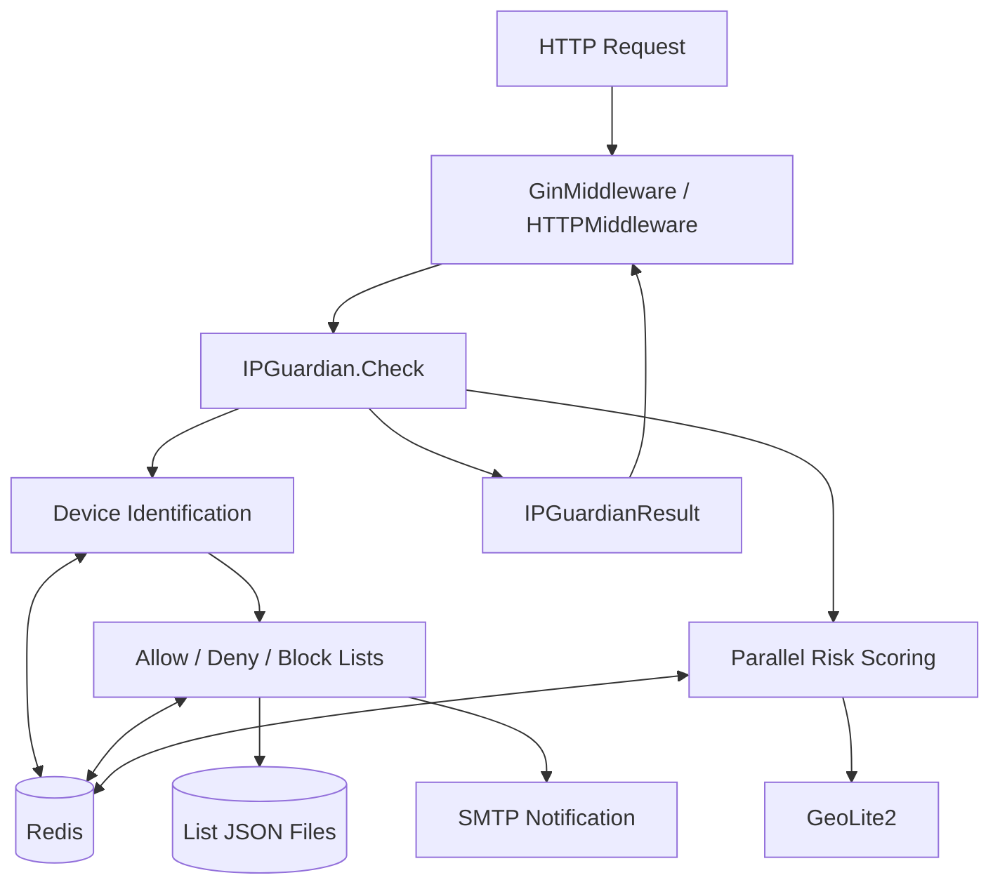

# Architecture

This page shows the go-ip-sentry layers in one diagram and lists each layer's responsibility and the cross-cutting rules.

## System Overview

## Layers

| Layer | Source | Responsibility |
|---|---|---|
| Middleware | `middleware.go` | Wires `Check` into Gin or `net/http` and writes a JSON error on failure |
| Check flow | `instance.go` | Creates the instance, applies rate-limit defaults, then runs list checks, scoring, and rate limits in order |
| Device identification | `device.go` | Resolves client IP, User-Agent, the HMAC-signed session, and the device fingerprint, with list status and per-minute counts |
| Dynamic scoring | `score.go` | Four goroutines (correlation, geo, behavior, fingerprint) compute in parallel and merge into a 0–100 score |
| Geo detection | `geo.go` | GeoLite2 lookups, a 24-hour cache, and risk checks over the location history |
| List management | `allow.go` / `deny.go` / `block.go` | Permanent Allow/Deny lists (Redis plus JSON file) and temporary Block (Redis TTL) |
| Types and constants | `type.go` | `Config`, `Parameter`, Redis key templates, private CIDRs |

These layers run inside one `Check` call. Related Go packages each describe a single job in their repositories: didip/tollbooth, ulule/limiter, mennanov/limiters, and JGLTechnologies/gin-rate-limit are rate limiters, jpillora/ipfilter is an IP filtering package, and teler-sh/teler-waf is a WAF middleware against OWASP Top 10 threats. go-ip-sentry puts allow/deny/block lists, tiered per-minute rate limits, and risk scoring from session, IP, and device correlation, request timing, and GeoLite2 location into one middleware, and it does not inspect request bodies or match attack signatures.

## Cross-Cutting Rules

| Rule | Implementation |
|---|---|
| All state lives in Redis | Counters, sets, lists, and the geo cache sit in Redis; an instance only keeps Allow/Deny memory caches, so instances sharing one Redis share decisions |
| Allow beats everything | `Check` tests Trust first and skips blocking, scoring, and rate limits on a hit |
| Lazy defaults | Most `Parameter` defaults are not set in `New()` but written back into `Config` on each request |
| Scores stay internal | `Check` returns only `IPGuardianResult`; scores and triggered flags are not exposed |

## Further Reading

- [Request Lifecycle](/request-lifecycle): the order of checks in `Check` and its responses
- [Risk Scoring](/risk-scoring): how the score is built
- Full module-level diagrams (per-module, sequence, state machine): [doc/architecture.md](https://github.com/pardnchiu/go-ip-sentry/blob/main/doc/architecture.md)
