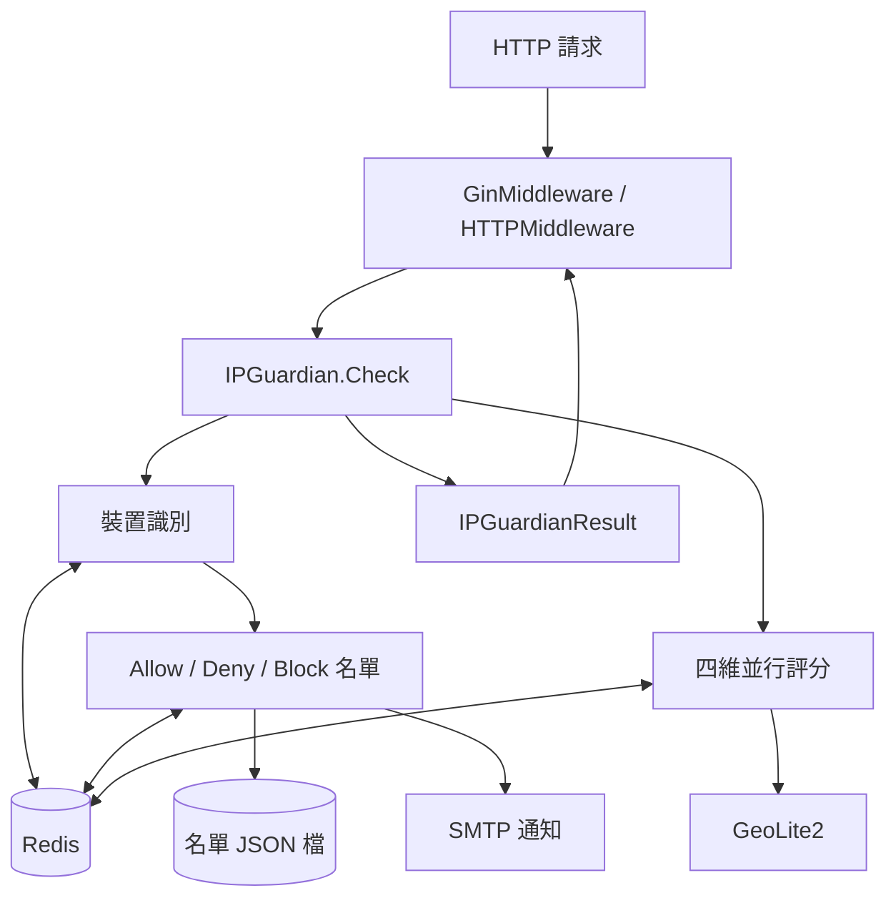

# 架構

本頁以一張圖呈現 go-ip-sentry 的分層關係，並列出各層職責與跨層原則。

## 系統概覽

## 分層

| 層 | 原始檔 | 職責 |
|---|---|---|
| 中介層 | `middleware.go` | 把 `Check` 接到 Gin 或 `net/http`，失敗時輸出 JSON 錯誤 |
| 檢查流程 | `instance.go` | 建立實例、套用速率預設值、依序執行名單判定、評分與速率限制 |
| 裝置識別 | `device.go` | 解析用戶端 IP、User-Agent、HMAC 簽章 Session 與裝置指紋，附帶名單狀態與每分鐘計數 |
| 動態評分 | `score.go` | 關聯、地理、行為、指紋四個 goroutine 並行計算並合併為 0–100 分 |
| 地理偵測 | `geo.go` | GeoLite2 查詢、24 小時快取與位置歷史風險判定 |
| 名單管理 | `allow.go`／`deny.go`／`block.go` | Allow／Deny 永久名單（Redis＋JSON 檔）、Block 暫時封鎖（Redis TTL） |
| 型別與常數 | `type.go` | `Config`、`Parameter`、Redis key 樣板、內網 CIDR |

以上各層都在同一次 `Check` 呼叫內完成。相關的 Go 套件在各自 repo 描述的是單一功能：didip/tollbooth、ulule/limiter、mennanov/limiters、JGLTechnologies/gin-rate-limit 是限流器，jpillora/ipfilter 是 IP 過濾套件，teler-sh/teler-waf 是防護 OWASP Top 10 威脅的 WAF 中介層。go-ip-sentry 把 Allow／Deny／Block 名單、分級每分鐘限流，以及依 Session／IP／裝置關聯、請求節奏與 GeoLite2 位置計算的風險評分放進同一個中介層，不檢查請求內容、也不比對攻擊特徵。

## 跨層原則

| 原則 | 實作 |
|---|---|
| 狀態全在 Redis | 計數、集合、名單、地理快取都存 Redis，實例本身只有 Allow／Deny 記憶體快取；多實例共用同一個 Redis 即共用判定 |
| Allow 優先於一切 | `Check` 先判 Trust，命中即跳過封鎖、評分與速率限制 |
| 延遲套用預設值 | 多數 `Parameter` 預設值不在 `New()`，而是在每次請求時寫回 `Config` |
| 結果不外露分數 | `Check` 只回傳 `IPGuardianResult`，分數與觸發的 flag 不對外提供 |

## 延伸閱讀

- [請求流程](/zh/request-lifecycle)：`Check` 的判定順序與回應
- [風險評分](/zh/risk-scoring)：分數如何組成
- 模組級完整圖（各模組圖、時序圖、狀態機）：[doc/architecture.zh.md](https://github.com/pardnchiu/go-ip-sentry/blob/main/doc/architecture.zh.md)
