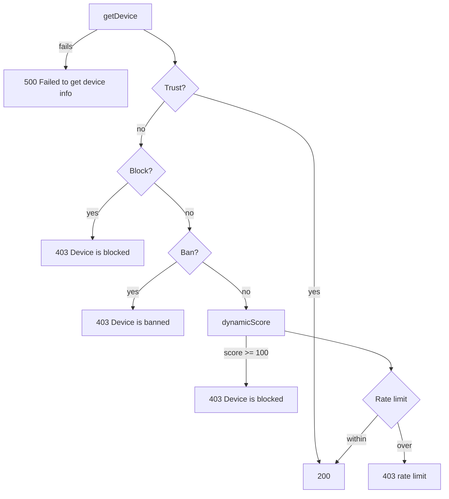

# Request Lifecycle

This page explains the order in which `IPGuardian.Check` evaluates a request, the side effects every call leaves behind, and the effective per-minute rate limits.

## Check Order

| Step | Condition | Result |
|---|---|---|
| 1 | IP cannot be resolved or session cannot be signed | `500`, `Failed to get device info` |
| 2 | IP is on the Allow list | `200`, skips every later step |
| 3 | IP is within a Block period | `403`, `Device is blocked, IP: {ip}` |
| 4 | IP is on the Deny list | `403`, `Device is banned, IP: {ip}` |
| 5 | Combined score `>= 100` | `403`, `Device is blocked, IP: {ip}` |
| 6 | Score `>= ScoreDangerous` and per-minute requests `>= RateLimitDangerous` | `403`, `... rate limit (Dangerous) ...` |
| 7 | Score `>= ScoreSuspicious` and per-minute requests `>= RateLimitSuspicious` | `403`, `... rate limit (Suspicious) ...` |
| 8 | Per-minute requests `>= RateLimitNormal` | `403`, `... rate limit (Normal) ...` |
| 9 | None of the above | `200` |

## Side Effects on Every Check

`getDevice` runs before any list check, so these happen even when the request is rejected:

| Side effect | Detail |
|---|---|
| `frequency:{ip}:{minute}` increments | Per-minute request count, windowed by Unix minute rather than sliding |
| Two `Set-Cookie` headers | `conn.sess.id` and `conn.device.id`, refreshed on every request |
| `block:count:{ip}` increments | Only while the IP is blocked |

The scoring step also writes each dimension's Redis sets and lists; see [Redis Keys](/redis-keys).

## Effective Rate Limits

The count includes the current request and compares with `>=`, so a setting of `N` admits at most `N - 1` requests per minute. With defaults:

| Tier | Setting | Admitted per minute |
|---|---|---|
| Normal | `100` | 99 |
| Suspicious | `50` | 49 |
| Dangerous | `20` | 19 |

Windows split on whole Unix minutes and reset at the boundary, so a burst straddling two minutes can pass up to roughly twice the limit.

For how failures inside `Check` are handled and the JSON error body, see [Errors and Responses](/request-lifecycle-errors).
