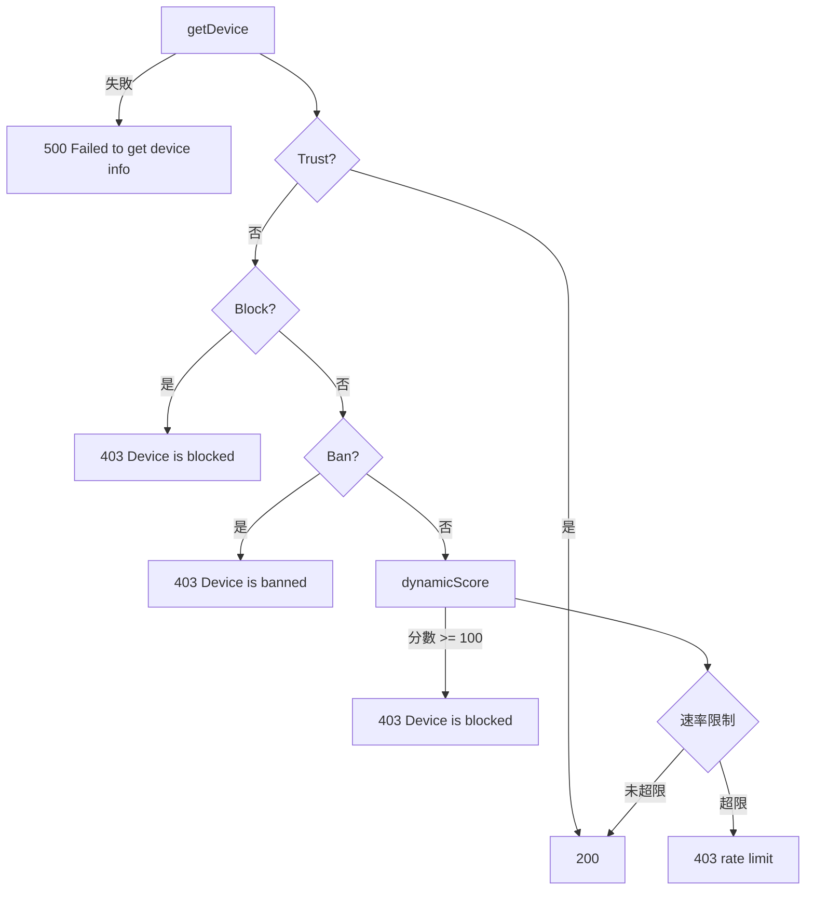

# 請求流程

本頁說明 `IPGuardian.Check` 對單一請求的判定順序、每次呼叫留下的副作用，以及每分鐘速率限制的實際上限。

## 判定順序

| 步驟 | 條件 | 結果 |
|---|---|---|
| 1 | 無法解析 IP 或簽發 Session | `500`，`Failed to get device info` |
| 2 | IP 在 Allow 名單 | `200`，跳過後續所有步驟 |
| 3 | IP 處於 Block 期間 | `403`，`Device is blocked, IP: {ip}` |
| 4 | IP 在 Deny 名單 | `403`，`Device is banned, IP: {ip}` |
| 5 | 四維評分總分 `>= 100` | `403`，`Device is blocked, IP: {ip}` |
| 6 | 分數 `>= ScoreDangerous` 且每分鐘請求數 `>= RateLimitDangerous` | `403`，`... rate limit (Dangerous) ...` |
| 7 | 分數 `>= ScoreSuspicious` 且每分鐘請求數 `>= RateLimitSuspicious` | `403`，`... rate limit (Suspicious) ...` |
| 8 | 每分鐘請求數 `>= RateLimitNormal` | `403`，`... rate limit (Normal) ...` |
| 9 | 以上皆未命中 | `200` |

## 每次 Check 都會發生的副作用

`getDevice` 在名單判定之前就執行，因此即使請求最後被拒絕：

| 副作用 | 說明 |
|---|---|
| `frequency:{ip}:{minute}` 加 1 | 每分鐘請求計數；以 Unix 分鐘切窗，不是滑動視窗 |
| 寫入兩個 `Set-Cookie` | `conn.sess.id` 與 `conn.device.id`，每次都刷新有效期 |
| `block:count:{ip}` 加 1 | 只在 IP 處於 Block 期間 |

評分步驟另外會寫入各維度的 Redis 集合與列表，見 [Redis Key](/zh/redis-keys)。

## 速率限制的實際上限

計數包含當前請求且以 `>=` 比較，所以設定值 `N` 代表同一分鐘最多放行 `N - 1` 個請求。以預設值為例：

| 分級 | 設定 | 同一分鐘可通過 |
|---|---|---|
| Normal | `100` | 99 |
| Suspicious | `50` | 49 |
| Dangerous | `20` | 19 |

視窗以 Unix 時間的整分鐘切割，跨分鐘邊界時計數歸零，短時間內最多可通過約兩倍上限。

`Check` 內部失敗的處理方式與 JSON 錯誤格式見 [錯誤與回應](/zh/request-lifecycle-errors)。
